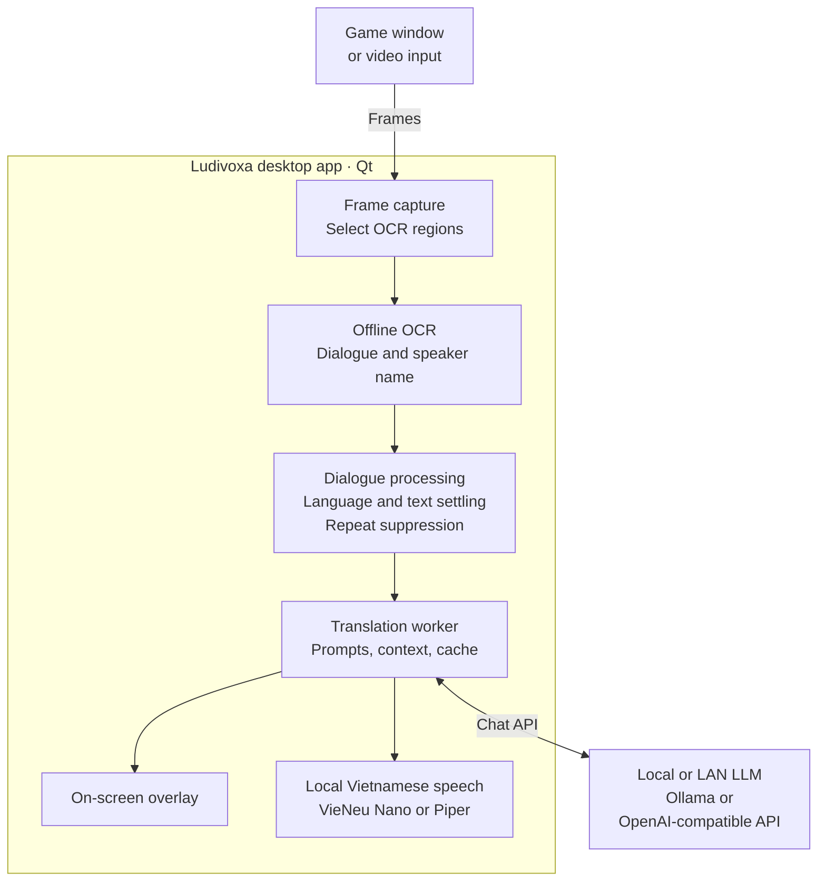

# Ludivoxa — Offline Game Translator with OCR and Vietnamese TTS

**Ludivoxa** is an open-source screen translator for PC games. It reads English,
Japanese, Chinese and Korean dialogue with offline OCR, translates it into
Vietnamese by default using a local LLM, and shows the result over the game or
reads it aloud. Use it for visual novels, RPGs and other games with on-screen
dialogue.

[Download for Windows](#install-on-windows) · [Set up game translation](#translate-your-first-game-dialogue) ·
[Documentation](https://ludivoxa.hungdx.com/en/) · [Tiếng Việt](README.vi.md)

**Stable release v2.0.0** gives the Python package, CLI and Windows executable
the Ludivoxa name. Windows upgrades retain settings and models.
[Release notes](docs/releases/v2.0.0.md)

## Game translation features

### Offline screen OCR for English, Japanese, Chinese and Korean

Use the fast English PaddleOCR profile or select Japanese, Chinese or Korean.
**Auto** is intended for mixed English/Japanese dialogue. Save multiple dialogue boxes
per game and scan them in one pass. Full-window capture and exclusion zones
are also available. Choose a game window or a video capture device as input.

### Local LLM translation with Ollama or a LAN server

Choose Vietnamese, English, Simplified or Traditional Chinese, Japanese,
Korean, or enter a custom target language. Use the bundled
Ollama runtime, your own local Ollama instance, or a compatible API on a LAN
GPU server. Dialogue context, custom prompts and speaker metadata help carry
names and forms of address between lines.

### On-screen translations and Vietnamese text-to-speech

Choose a subtitle banner, translations at the original text positions, speech,
or a combination. Local TTS provides 11 VieNeu Nano presets, optional voice
cloning from a local recording and 67 Piper speaker choices in the full Windows
package. Assign a voice by character name using a separate name box. TTS reads
the dialogue, and you can adjust its volume independently. The overlay can
clear the old translation while the next line is being translated.

### Dialogue history, game profiles and diagnostics

Replay, copy or retranslate recent dialogue from History. Save the source
language, prompt and ignored OCR phrases per game. Use Diagnostics to check
capture, OCR, translation and audio or copy a report for a bug ticket.

## Install on Windows

The offline installer targets **Windows x64**. It includes Python, Ollama,
HauhauCS Qwen3 4B Aggressive Q4_K_M, English and Japanese OCR models, and
Vietnamese TTS. The full download is about **4.9 GB** and uses about **6.4 GB**
after installation.

1. Download the setup EXE and **all three BIN files** from the
   [v1.1.1 full offline installer](https://github.com/hungdinhxuan/Ludivoxa/releases/tag/v1.1.1).
2. Check the downloads against `SHA256SUMS.txt`, put all four files in one
   directory, and run the EXE.
3. Open **Updates → Check for updates** and install the current stable version.

Use the files under **Assets** for Windows installation. The **Source code**
archives are for development.

**Already installed?** Use **Updates** or run the standard **App-Update.exe**
from the [latest stable release](https://github.com/hungdinhxuan/Ludivoxa/releases/latest)
and select the existing installation directory. Upgrading to v2.0.0 uses the
standard app update to install `Ludivoxa.exe` and keeps your models, Ollama
runtime and `config.yml`. GitHub release downloads work without sign-in. The
Windows installer is unsigned.

## Translate your first game dialogue

1. Open the game in windowed or borderless mode, choose its window in
   Ludivoxa and select **Start Capture**.
2. Open **Configure OCR**, choose **Only selected boxes**, and draw the dialogue
   regions. Select **OK** to save them for that game.
3. In **Engines**, choose **English** and `en_PP-OCRv5_mobile_rec` for English
   games. Use **Japanese** or **Auto** with `PP-OCRv5_mobile_rec` for Japanese
   or mixed English/Japanese dialogue. Select **Chinese** or **Korean** with
   **PaddleOCR** to load the corresponding local recognizer.
4. Choose **Overlay only**, **TTS only** or **Overlay + TTS**. Use **F8** to
   toggle subtitles and **Stop reading** to stop speech.

The offline profile runs OCR, translation and speech on your PC after
installation. Its private Ollama endpoint is `http://127.0.0.1:11435`.
You can set another local endpoint or a LAN server in **Engines**. The app
uses the configured endpoint without automatic cloud fallback. Other targets
use the overlay automatically. The bundled voices read Vietnamese.
[Local and LAN setup](docs/USER_GUIDE.md#ollama-local-và-gpu-server-lan)

## Architecture



When configured, speaker-name OCR supplies context to the LLM and selects the
voice for speech. Background workers handle OCR and speech, and VieNeu Nano
streams audio as it becomes available. MeikiOCR and owocr are alternative OCR
backends. Sugoi V4 translates Japanese into English.

The bundled Ollama process stops when the last instance closes. Shared local
and LAN servers run independently. The Windows updater uses GitHub Releases
and can check for updates at startup if enabled.

## TTFA benchmarks by version

**TTFA (time to first audio)** runs from a complete saved frame becoming
available to the first matching speech observed in Windows audio loopback.
It includes OCR, text stabilization, translation, synthesis and output delay.
Values below are **medians of three warm trials per case**, in milliseconds;
lower is faster.

| Version / measured profile | Short game dialogue | Two English sentences (synthetic) | Long game paragraph |
| --- | ---: | ---: | ---: |
| v1.0.0 — buffered baseline | 1,413.6 ms | 1,743.6 ms | 4,465.2 ms |
| v1.1.0 — streaming profile¹ | 912.6 ms | 1,013.6 ms | 1,436.9 ms |
| Historical reduction versus v1.0.0 | **35.4%** | **41.9%** | **67.8%** |
| v1.1.0 — released tag² | 896.1 ms | 1,038.6 ms | 1,439.5 ms |
| v1.1.1 — released tag² | 888.0 ms | 971.2 ms | 1,433.6 ms |
| v1.1.2-rc.1 — released tag² | 866.5 ms | 849.3 ms | 1,364.3 ms |
| v1.1.2 stable — released tag² | **867.7 ms** | **966.3 ms** | **1,355.9 ms** |
| v1.1.3 stable | Not measured | Not measured | Not measured |
| v1.2.0 stable | Separate game test below | Not measured | Not measured |
| v1.3.0 stable | Separate frame replay below | Separate frame replay below | Not measured |
| v1.3.1 stable | Synthetic short replay below | **1,014.42 ms** in frame replay | Not measured |
| v1.4.0 stable | Synthetic two-sentence replay | **1,108.41 ms** in frame replay | Not measured |
| v1.5.0 stable | Synthetic two-sentence replay | **914.23 ms** in frame replay | Not measured |

In v1.5.0, the median TTFA was about **0.91 s** on two synthetic dialogue samples.
[v1.5.0 trials and conditions](docs/PERFORMANCE.md#v150-windows-frame-replay)

<details>
<summary>Measurement notes and historical results</summary>

Measured on Windows 11, Core i7-13700F and RTX 4090 24 GB, using the same saved
dialogue crops, English OCR → Vietnamese, local HauhauCS Qwen3 4B Q4_K_M,
three seeded context pairs, and VieNeu Nano speaker 7 at eight steps/two CPU
threads. No previous speech was queued. The comparison includes the move
from buffered/MME output to streaming/WASAPI output on the same speaker endpoint.

¹ The streaming measurements were collected during v1.1.0 development, before
the final prompt/updater changes; the published installer was not separately
re-benchmarked. These trials exclude model loading, native capture phase,
game typewriter reveal and waiting for earlier speech. They do not measure
live game FPS, acoustic speaker latency or p95 latency.

² Measured on 2026-11-16 from the exact release-tag sources in an active
Windows console session, with unrelated audio paused: **36 valid loopback
trials**, three per input/tag. All used streaming/shared WASAPI at 48 kHz,
the same Qwen/Nano profile, Ollama context 2048 and the per-tag default prompt.
Waveform correlations were 0.958–1.000. These are warm, complete-frame results;
small differences across three trials do not establish a version speed ranking.
The historical percentage row applies only to the first two historical profiles.
See the [tagged-run method](docs/PERFORMANCE.md#tagged-version-loopback-ttfa)
and [individual samples](docs/benchmarks/ttfa.json). Installers were not
independently benchmarked.

**Tagged-version measurements, 2026-11-16 — frame to native PCM callback.**
The three later versions have now been measured with the same saved inputs,
Qwen/Nano settings and WDM-KS output. Each value is a median of three warm
trials. v1.1.0 was rerun on this output path as a control.

| Tagged source / WDM-KS | Short game dialogue | Two English sentences (synthetic) | Long game paragraph |
| --- | ---: | ---: | ---: |
| v1.1.0 — control | 3,914.3 ms | 4,448.3 ms | 15,644.1 ms |
| v1.1.1 | 3,515.8 ms | 4,450.3 ms | 15,404.5 ms |
| v1.1.2-rc.1 | 3,984.6 ms | 4,240.7 ms | 15,543.2 ms |
| v1.1.2 stable | 3,987.0 ms | 4,332.1 ms | 15,585.3 ms |

**These are driver-side observations, not loopback TTFA.** The Windows session
was disconnected and exposed no WASAPI loopback endpoint. Production WDM-KS
playback buffers the complete synthesized utterance, including all streamed
chunks, before output; its roughly 61 ms device buffer is only part of that wait.
The v1.1.0 control shows the same long wait on this path. Do not compare these
numbers directly with the earlier streaming/WASAPI table or infer small version
speed differences from three trials. The active-console loopback results are
now available in the first table; this earlier disconnected-session run is
retained as a separate output-path measurement. See the
[method and play-request timings](docs/PERFORMANCE.md#tagged-version-native-callback-audit)
and [all 36 timing samples](docs/benchmarks/ttfa-native-callback.json).

v1.1.1 fixes repeated speech from OCR word-box jitter, animated dialogue
cursors and streamed translation aliases, and negotiates supported audio
channel formats. A controlled replay with real OCR on ten saved GBA images
reduced speech requests from 10 to 1; it did not measure TTFA or synthesize
audio. Revealing text now waits adaptively, so earlier TTFA results are not
reused as measurements of this version. See the [patch validation](docs/PERFORMANCE.md#v111-live-gba-repeat-reproduction).

See [measurement details and reproduction](docs/PERFORMANCE.md#v110-streaming-profile)
and the [public timing samples](docs/benchmarks/ttfa.json). New versions will
get new rows when comparable measurements are available; different observation
methods are reported separately.

**v1.2.0 game test:** Character voices on, local Gemma 4 E4B Q4_K_M and Nano TTS.
Replaying four complete game lines with the full-window exclusions gave a
median of **1.23 s** over 12 WASAPI loopback measurements. In a separate
six-pair test of the same short line, a selected dialogue box reduced median
paired TTFA by **72 ms (7.5%)**, with a median of **0.82 s** inside the box.
These tests measured the release candidate code on saved game frames. Game
text reveal and earlier queued speech are outside the measurement. See the
[v1.2.0 notes](docs/releases/v1.2.0.md) for the setup and limits.

**v1.3.0 Windows frame replay.** With the same Gemma and VieNeu settings,
median TTFA over four complete-frame pairs was **1.20 s with timer polling**
and **0.95 s with frame notifications**, a median paired saving of **209 ms**.
The replay uses synthetic dialogue and measures first matching speech via
WASAPI. See [the individual results and scope](docs/PERFORMANCE.md#v130-windows-frame-replay).

**v1.3.1 Windows frame replay.** Median TTFA was **897.24 ms** for a short
synthetic dialogue and **1,014.42 ms** for two English sentences, with three
WASAPI trials each. [Individual trials and setup](docs/PERFORMANCE.md#v131-windows-frame-replay)

**v1.4.0 Windows frame replay.** Median TTFA was **1,028.81 ms** for a short
dialogue and **1,108.41 ms** for two sentences. [Trials and test conditions](docs/PERFORMANCE.md#v140-windows-frame-replay)

**v1.5.0 Windows frame replay.** Median TTFA was **910.24 ms** for a short
dialogue and **914.23 ms** for two sentences. [Trials and test conditions](docs/PERFORMANCE.md#v150-windows-frame-replay)

</details>

## Develop and build

Python 3.11/3.12 and `uv` are used for source development. Copy
`config.example.yml` to `config.yml` and provision its local models **before**
running the offline source profile:

```powershell
uv sync --locked --extra paddle --extra tts --extra clone --group build
uv run ludivoxa
```

The package and CLI are both named `ludivoxa`. To install the CLI from the
checkout or build `Ludivoxa.exe`, see the [development guide](docs/DEVELOPMENT.md).

- [Changelog](CHANGELOG.md) and [published releases](https://github.com/hungdinhxuan/Ludivoxa/releases)
- [Development, provisioning and Windows builds](docs/DEVELOPMENT.md)
- [Release process and tagged artifacts](docs/RELEASING.md)
- [Measurements and limitations](docs/PERFORMANCE.md)
- [OneOCR and PaddleOCR pixel-dialogue comparison](benchmark/ocr/README.md#oneocr-and-paddleocr-on-pixel-dialogue)

OCR and synthesis timings depend on text length, font, region size and hardware.
Version 1.1.0 starts Nano speech from completed audio chunks; the
in-place overlay and callback-only driver paths retain buffered playback. Recorded-frame
benchmarks do not establish live game FPS or guarantee latency for every scene.

[MIT license](LICENSE) · [Attribution and third-party notices](NOTICE.md)
